# Отчёт по практической работе № 1

**Тема:** Подготовка окружения и первые программы на JavaScript

## 1. Автор и окружение

- Студент: Маркина Майя Витальевна
- Группа: ЭФБО-02-25
- Вариант: 8
- Операционная система: Windows 11
- Редактор кода: Visual Studio Code
- Node.js: v24.13.1
- npm: 11.6.2
- Git: 2.51.1.windows.1
- Браузер: Яндекс Браузер

## 2. Запуск программ

Для выполнения программ в Node.js использовался терминал Visual Studio Code.

Команды запуска из корневой папки проекта:

```bash
node practice-01/js/hello.js
node practice-01/js/types.js
node practice-01/js/progress.js
node practice-01/js/plan.js
node practice-01/js/debug.js
```

Для запуска в браузере использовался файл `practice-01/index.html`.

Необходимый JavaScript-файл подключался с помощью тега `script`. Результаты выполнения просматривались во вкладке Console инструментов разработчика, открываемых клавишей F12.

## 3. Задание 1. Один файл – две среды выполнения

**Цель:** Запустить один JavaScript-файл через Node.js и браузер, сравнить результаты выполнения.

### Описание выполнения

В файле `hello.js` были объявлены переменные с данными студента и номером практической работы. Для вывода информации использовался метод `console.log()`.

Программа была запущена через терминал Visual Studio Code и консоль браузера.

### Запуск через Node.js

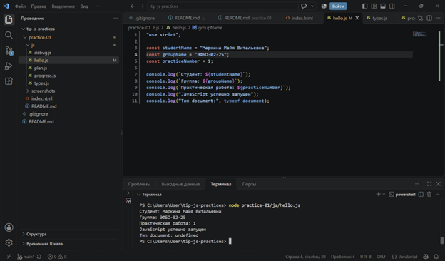

### Запуск в браузере

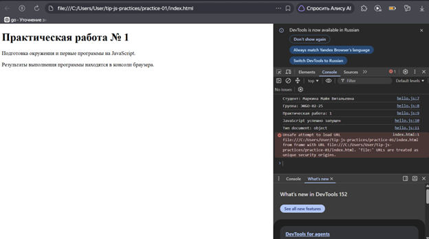

### Сравнение результатов

| Параметр | Node.js | Браузер |
|---|---|---|
| Данные студента | Выводятся | Выводятся |
| Номер практической работы | 1 | 1 |
| `typeof document` | `undefined` | `object` |

В обеих средах программа выводит одинаковые данные студента. Отличие заключается в наличии объекта `document`.

В браузере объект `document` представляет HTML-документ. В Node.js данный объект отсутствует, поскольку эта среда выполнения не работает с HTML-документом напрямую.

### Вывод

Один JavaScript-файл может выполняться в разных средах. При этом доступные глобальные объекты зависят от среды выполнения.

## 4. Задание 2. Исследование типов и преобразований

**Цель:** Изучить особенности преобразования типов данных, арифметических операций и сравнений в JavaScript.

### Описание выполнения

В файле `types.js` были проверены 10 выражений. Для каждого выражения определены результат и его тип с помощью оператора `typeof`.

### Результаты проверки

| Выражение | Ожидание до запуска | Фактическое значение | Тип результата | Объяснение |
|---|---|---|---|---|
| `"8" + 2` | `"82"` | `"82"` | `string` | Оператор `+` объединяет строку и число |
| `"8" - 2` | 6 | 6 | `number` | При вычитании строка преобразуется в число |
| `Number("8") + 2` | 10 | 10 | `number` | Явное преобразование строки в число |
| `"12" > "3"` | false | false | `boolean` | Строки сравниваются посимвольно |
| `12 === "12"` | false | false | `boolean` | Строгое равенство учитывает типы данных |
| `Number("")` | 0 | 0 | `number` | Пустая строка преобразуется в ноль |
| `Number("text")` | NaN | NaN | `number` | Строка не может быть преобразована в число |
| `Boolean("false")` | true | true | `boolean` | Непустая строка преобразуется в true |
| `typeof null` | `"object"` | `"object"` | `string` | Историческая особенность JavaScript |
| `typeof NaN` | `"number"` | `"number"` | `string` | NaN относится к числовому типу |

### Запуск через Node.js

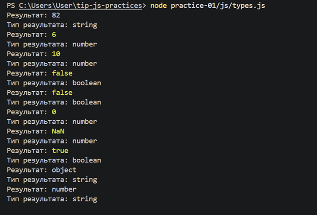

### Запуск в браузере

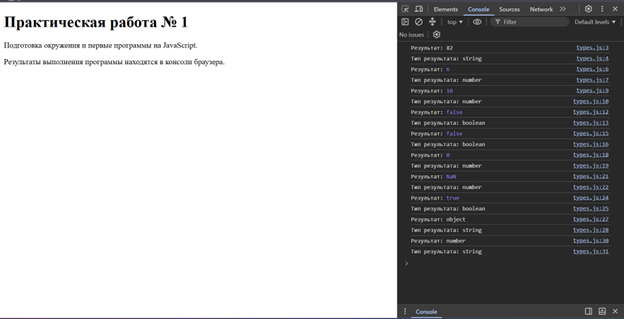

### Вывод

Все фактические результаты совпали с ожидаемыми. В ходе выполнения задания были изучены явные и неявные преобразования типов данных, особенности арифметических операций и строгого сравнения в JavaScript.

## 5. Задание 3. Сводка выполнения задач

**Цель:** Разработать программу для расчёта прогресса выполнения задач с проверкой корректности входных данных.

### Описание выполнения

В файле `progress.js` реализована программа, которая определяет количество оставшихся задач, процент выполнения и текущий статус.

Для расчётов использованы переменные `totalTasks` и `completedTasks`.

Перед выполнением вычислений программа проверяет:

- являются ли значения целыми числами;
- находится ли общее количество задач в диапазоне от 0 до 1000;
- является ли количество выполненных задач неотрицательным;
- не превышает ли количество выполненных задач общее количество.

Если входные данные некорректны, выводится сообщение об ошибке.

Если общее количество задач равно нулю, выводится сообщение «Задач пока нет».

В остальных случаях вычисляются количество оставшихся задач и процент выполнения. В зависимости от количества выполненных задач определяется статус: «Не начато», «В работе» или «Завершено».

Для округления процента до одного знака после точки используется метод `toFixed(1)`.

### Исходные данные варианта № 8

| Переменная | Значение |
|---|---|
| `totalTasks` | 14 |
| `completedTasks` | 4 |

### Результаты проверки

| № | Входные данные | Ожидаемый результат | Фактический результат | Итог |
|---|---|---|---|---|
| 1 | 12; 5 | Осталось 7, 41.7%, В работе | Осталось 7, 41.7%, В работе | Пройдено |
| 2 | 0; 0 | Задач пока нет | Задач пока нет | Пройдено |
| 3 | 5; 0 | Осталось 5, 0.0%, Не начато | Осталось 5, 0.0%, Не начато | Пройдено |
| 4 | 5; 5 | Осталось 0, 100.0%, Завершено | Осталось 0, 100.0%, Завершено | Пройдено |
| 5 | 5; 6 | Ошибка | Ошибка | Пройдено |
| 6 | -1; 0 | Ошибка | Ошибка | Пройдено |
| 7 | 5; 2.5 | Ошибка | Ошибка | Пройдено |
| 8 | `"5"`; 2 | Ошибка | Ошибка | Пройдено |
| 9 | 1001; 0 | Ошибка | Ошибка | Пройдено |
| 10 | NaN; 0 | Ошибка | Ошибка | Пройдено |
| 11 | 14; 4 (вариант 8) | Осталось 10, 28.6%, В работе | Осталось 10, 28.6%, В работе | Пройдено |

### Скриншоты выполнения

#### Проверка 1. Значения 12 и 5

Node.js:

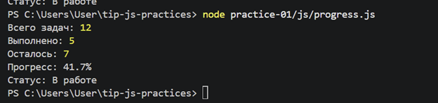

Браузер:

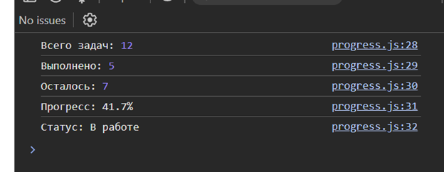

#### Проверка 2. Значения 0 и 0

Node.js:

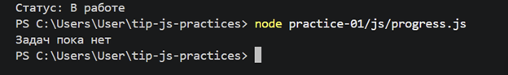

Браузер:

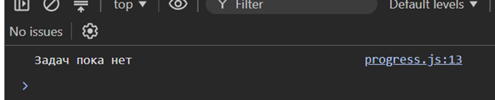

#### Проверка 3. Значения 5 и 0

Node.js:

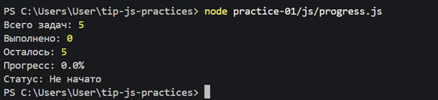

Браузер:

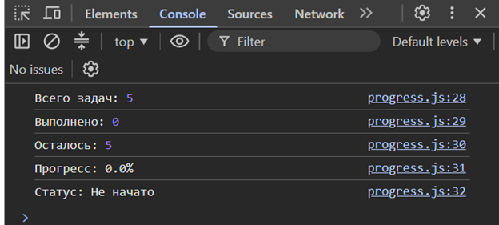

#### Проверка 4. Значения 5 и 5

Node.js:

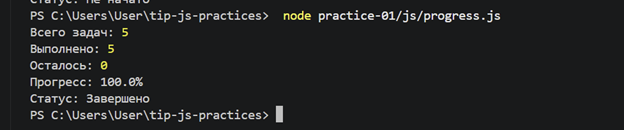

Браузер:

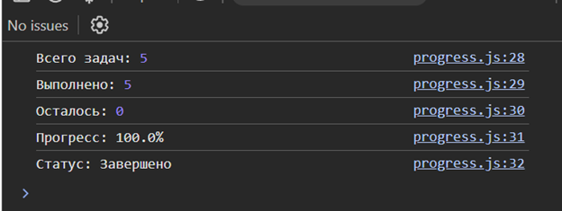

#### Проверка 5. Значения 5 и 6

Node.js:

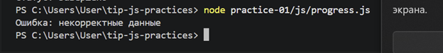

Браузер:

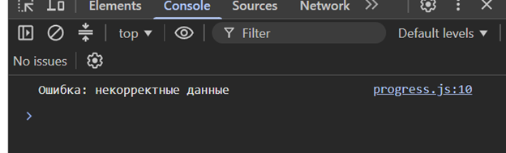

#### Проверка 6. Значения -1 и 0

Node.js:

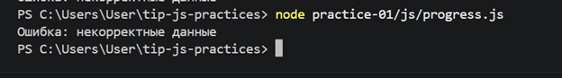

Браузер:

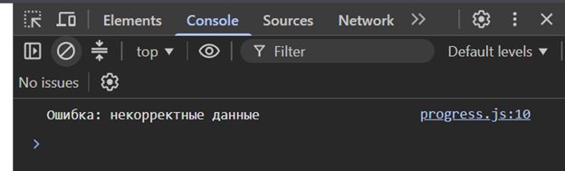

#### Проверка 7. Значения 5 и 2.5

Node.js:

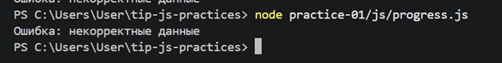

Браузер:

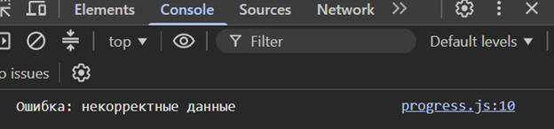

#### Проверка 8. Значения "5" и 2

Node.js:

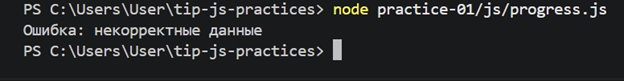

Браузер:

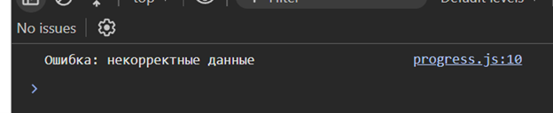

#### Проверка 9. Значения 1001 и 0

Node.js:

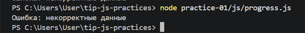

Браузер:

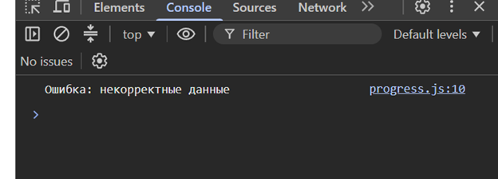

#### Проверка 10. Значения NaN и 0

Node.js:

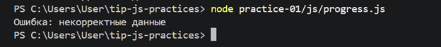

Браузер:

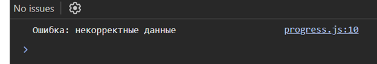

#### Проверка 11. Индивидуальный вариант № 8

Результат выполнения:

```text
Всего задач: 14
Выполнено: 4
Осталось: 10
Прогресс: 28.6%
Статус: В работе
```

Node.js:

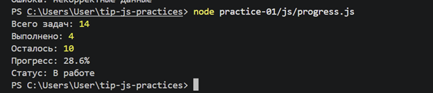

Браузер:

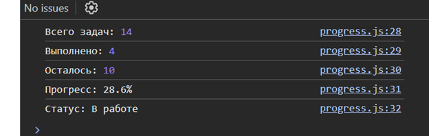

### Вывод

В ходе выполнения задания разработана программа для расчёта прогресса выполнения задач. Реализованы проверка входных данных, обработка граничных случаев и определение статуса выполнения.

Использованы условные конструкции `if`, `else if`, `else`, методы `Number.isInteger()` и `toFixed()`.

Все 11 проверок успешно пройдены в Node.js и браузере.

## 6. Задание 4. План выполнения задач по дням

**Цель:** Разработать программу для определения количества дней, необходимых для выполнения оставшихся задач, с использованием цикла `while`.

### Описание выполнения

В файле `plan.js` реализована программа планирования выполнения задач по дням.

Перед началом расчётов выполняется проверка входных данных. Общее количество задач и количество выполненных задач должны соответствовать ограничениям предыдущего задания. Дневной лимит должен быть целым числом от 1 до 1000.

Количество оставшихся задач вычисляется как разность между общим количеством и количеством выполненных задач.

Для планирования используется цикл `while`, который выполняется до тех пор, пока остаются невыполненные задачи.

На каждой итерации увеличивается номер дня, определяется количество задач на текущий день и уменьшается остаток.

Для ограничения количества задач используется метод `Math.min()`. Он позволяет не превышать дневной лимит и количество оставшихся задач.

### Исходные данные варианта № 8

| Переменная | Значение |
|---|---|
| `totalTasks` | 14 |
| `completedTasks` | 4 |
| `dailyLimit` | 4 |

### Результаты проверки

| № | Входные данные | Ожидаемый результат | Фактический результат | Итог |
|---|---|---|---|---|
| 1 | 12; 5; 3 | 3 дня (3, 3, 1) | 3 дня (3, 3, 1) | Пройдено |
| 2 | 10; 4; 3 | 2 дня (3, 3) | 2 дня (3, 3) | Пройдено |
| 3 | 5; 3; 10 | 1 день (2 задачи) | 1 день (2 задачи) | Пройдено |
| 4 | 5; 5; 2 | 0 дней | 0 дней | Пройдено |
| 5 | 0; 0; 2 | 0 дней | 0 дней | Пройдено |
| 6 | 5; 2; 0 | Ошибка | Ошибка | Пройдено |
| 7 | 5; 2; 1.5 | Ошибка | Ошибка | Пройдено |
| 8 | 5; 6; 2 | Ошибка | Ошибка | Пройдено |
| 9 | 5; 2; `"2"` | Ошибка | Ошибка | Пройдено |
| 10 | 5; 2; 1001 | Ошибка | Ошибка | Пройдено |
| 11 | 14; 4; 4 (вариант 8) | 3 дня (4, 4, 2) | 3 дня (4, 4, 2) | Пройдено |

### Скриншоты выполнения

#### Проверка 1. Значения 12, 5, 3

Node.js:

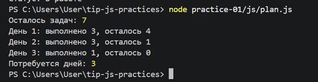

Браузер:

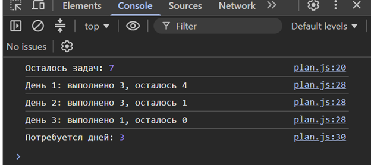

#### Проверка 2. Значения 10, 4, 3

Node.js:

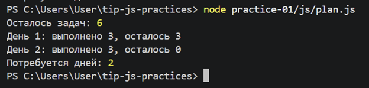

Браузер:

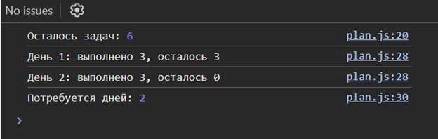

#### Проверка 3. Значения 5, 3, 10

Node.js:

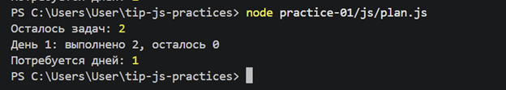

Браузер:

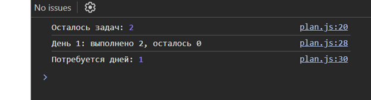

#### Проверка 4. Значения 5, 5, 2

Node.js:

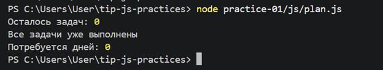

Браузер:

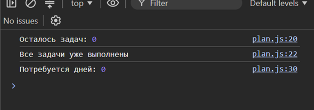

#### Проверка 5. Значения 0, 0, 2

Node.js:

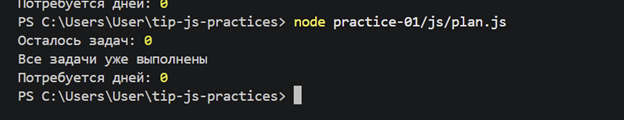

Браузер:

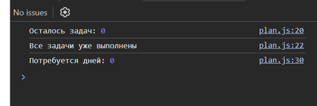

#### Проверка 6. Значения 5, 2, 0

Node.js:

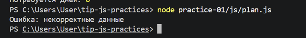

Браузер:

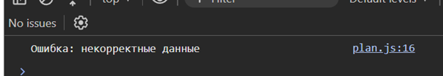

#### Проверка 7. Значения 5, 2, 1.5

Node.js:

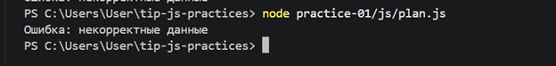

Браузер:

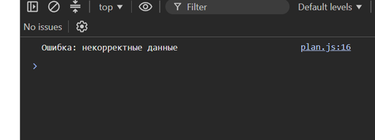

#### Проверка 8. Значения 5, 6, 2

Node.js:

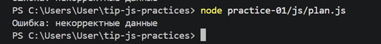

Браузер:

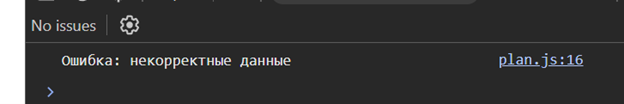

#### Проверка 9. Значения 5, 2, "2"

Node.js:

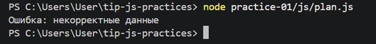

Браузер:

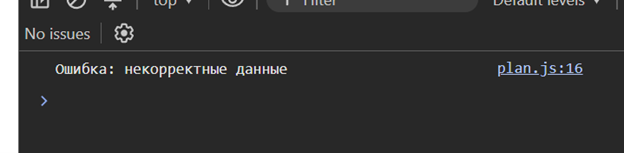

#### Проверка 10. Значения 5, 2, 1001

Node.js:

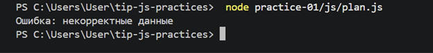

Браузер:

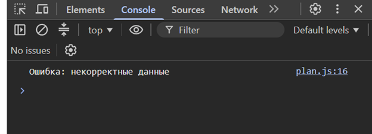

#### Проверка 11. Индивидуальный вариант № 8

Результат выполнения:

```text
Осталось задач: 10
День 1: выполнено 4, осталось 6
День 2: выполнено 4, осталось 2
День 3: выполнено 2, осталось 0
Потребуется дней: 3
```

Node.js:

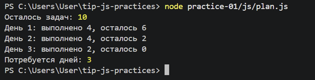

Браузер:

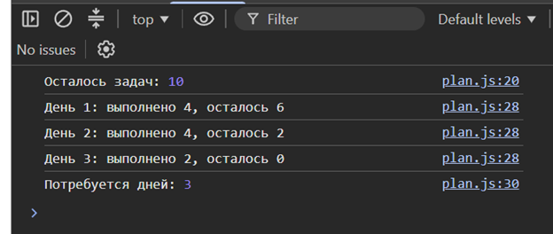

### Вывод

В ходе выполнения задания разработана программа планирования выполнения задач по дням.

Использован цикл `while`, реализована проверка входных данных и обработка случая отсутствия оставшихся задач.

Применение `Math.min()` позволяет корректно определять количество задач, выполняемых в последний день.

Все 11 проверок успешно пройдены в Node.js и браузере.

## 7. Задание 5. Поиск логических ошибок через DevTools

**Цель:** Изучить возможности отладки JavaScript-программ с использованием инструментов разработчика браузера и исправить логические ошибки.

### Описание выполнения

В файле `debug.js` была представлена программа с двумя логическими ошибками: неправильным сложением строковых значений и некорректной границей цикла.

Для поиска ошибок использовались инструменты разработчика браузера, вкладка Sources, точки останова и пошаговое выполнение программы.

### Результат до исправления

```text
Выполнено: 32
Осталось: -24
Контрольная сумма: 6
```

### Первая ошибка. Сложение строк

Исходная строка программы:

```javascript
const completedTotal = completedText + additionalText;
```

Переменные `completedText` и `additionalText` содержали строковые значения `"3"` и `"2"`.

При использовании оператора `+` произошло объединение строк, в результате чего было получено значение `"32"` вместо числа 5.

Для обнаружения ошибки была установлена точка останова на строке вычисления `completedTotal`. После пошагового выполнения в панели Scope было обнаружено строковое значение `"32"`.

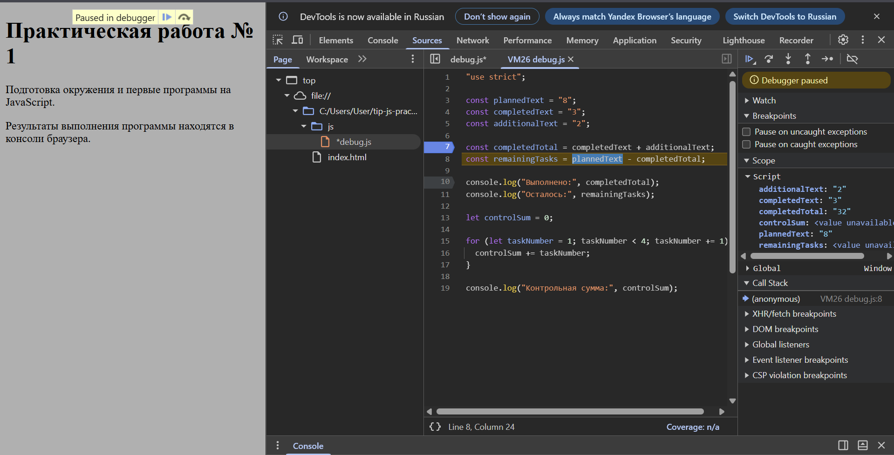

Для исправления использовано явное преобразование строк в числа:

```javascript
const completedTotal = Number(completedText) + Number(additionalText);
const remainingTasks = Number(plannedText) - completedTotal;
```

### Вторая ошибка. Неправильная граница цикла

Исходный цикл:

```javascript
for (let taskNumber = 1; taskNumber < 4; taskNumber += 1) {
    controlSum += taskNumber;
}
```

Условие `taskNumber < 4` позволяло выполнить только три итерации цикла.

При отладке была установлена точка останова внутри цикла на строке изменения `controlSum`.

Значения переменных перед выполнением строки:

| Итерация | taskNumber | controlSum |
|---|---|---|
| 1 | 1 | 0 |
| 2 | 2 | 1 |
| 3 | 3 | 3 |

Четвёртая итерация не выполнялась, поэтому контрольная сумма составляла 6 вместо 10.

Для исправления условие цикла было изменено:

```javascript
for (let taskNumber = 1; taskNumber <= 4; taskNumber += 1) {
    controlSum += taskNumber;
}
```

### Анализ обнаруженных ошибок

| Ошибка | Результат до исправления | Причина | Исправление | Результат после исправления |
|---|---|---|---|---|
| Сложение строк | Выполнено 32, осталось -24 | Оператор `+` объединял строки | Преобразование с помощью `Number()` | Выполнено 5, осталось 3 |
| Граница цикла | Контрольная сумма 6 | Число 4 не включалось в цикл | Замена `<` на `<=` | Контрольная сумма 10 |

### Результат после исправления

```text
Выполнено: 5
Осталось: 3
Контрольная сумма: 10
```

Запуск через Node.js:

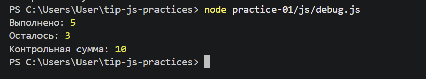

Запуск в браузере:


Результаты выполнения исправленной программы в Node.js и браузере совпали.

### Вывод

В ходе выполнения задания были изучены основные инструменты отладки JavaScript-программ: точки останова, пошаговое выполнение и просмотр значений переменных.

Обнаружены и исправлены две логические ошибки, связанные с преобразованием типов данных и границей цикла.

После исправления программа выдаёт правильные результаты в обеих средах выполнения.

## 8. Общий вывод

В ходе выполнения практической работы было подготовлено окружение для разработки программ на JavaScript.

Получены практические навыки запуска JavaScript-файлов в Node.js и браузере, работы с переменными, типами данных, арифметическими операциями, условными конструкциями и циклами.

Разработаны программы для расчёта прогресса выполнения задач и планирования их выполнения по дням. Реализована проверка корректности входных данных, исследованы обычные, граничные и ошибочные случаи.

Также были изучены инструменты разработчика браузера и способы поиска логических ошибок с помощью точек останова и пошагового выполнения программы.

Все пять основных заданий практической работы выполнены. Результаты проверок соответствуют ожидаемым значениям.
